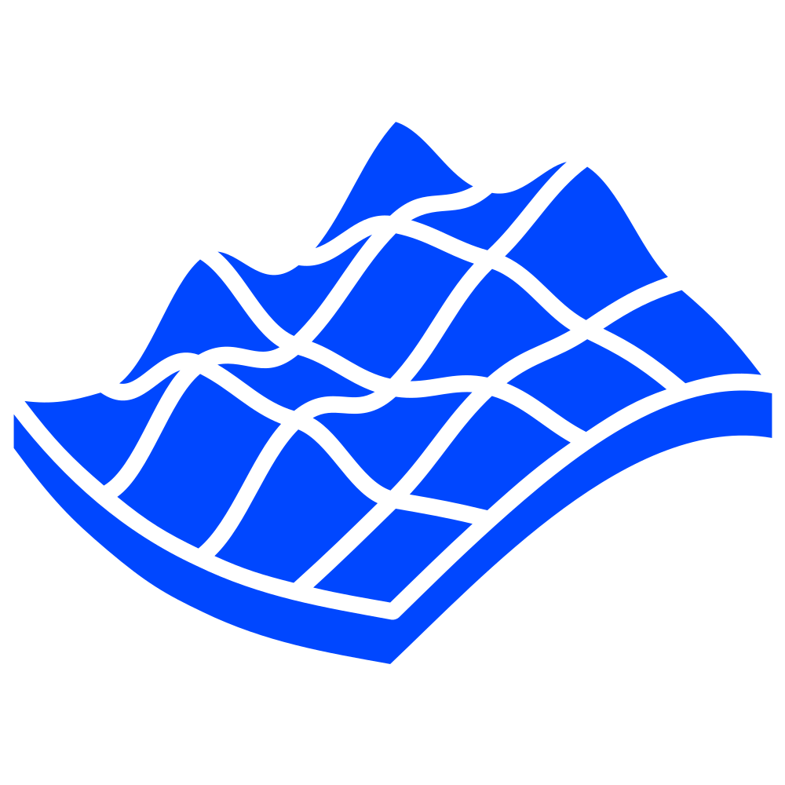

# Terrain Scenarios

Change the terrain as easily as you'd sketch on a map. Draw a line or an outline, choose what should happen (a dike, a ditch, a pond, a levelled pad) and the DEM updates immediately. You don't need a raster calculator, masks or any GIS expertise, and the original DEM is never touched.

Use the modified DEM wherever terrain matters: flood and drainage modelling, landscape and nature-based solution design, earthworks planning, or simply showing what a place could look like.

## Features

- **Seven terrain tools**
  - **Raise path / Lower path**: dikes, walls, ditches and swales that follow the ground between their ends.
  - **Raise flat / Lower flat**: level dams, building pads, culverts and retention basins.
  - **Interpolate**: a straight grade along a path or a smooth surface across an area, e.g. to cut through an embankment or fill an old ditch.
  - **Add to / Subtract from terrain**: raise or lower the ground by a fixed amount while keeping its relief.
- **Non-destructive**: every feature stays editable (shape, height, width, side slopes) and can be undone. The source DEM is never changed.
- **Live preview**: cross-section diagram on the feature page, long and cross profiles, and a 3D view.
- **Scenarios**: save the features to a GeoPackage and open them again later on the same DEM.
- **Export**: write the modified DEM to a 32-bit float GeoTIFF, ready for any model or tool that reads a DEM.

## Requirements

- QGIS 4.0 or later
- The Python package **scipy**. It's included in the standard QGIS installers for Windows and macOS. On Linux, install it with your package manager (e.g. `python3-scipy`).

## Getting started

1. In QGIS, open **Plugins ▸ Manage and Install Plugins**, enable **Show also experimental plugins** in Settings, then search for *Terrain Scenarios* and install it.
2. Load a DEM into your project.
3. Click the **Terrain Scenarios** toolbar button (also under **Raster ▸ Terrain Scenarios**), choose your DEM and press **Start**.
4. Under **New feature**, pick a tool, then draw a line or area on the map.
5. Fine-tune the feature's height, width and slopes on its page, and check the result in the cross-section, profiles or 3D view.
6. **Save scenario** to keep your work, and **Export DEM…** to write the modified DEM as a GeoTIFF.

## License

[MIT](LICENSE)
